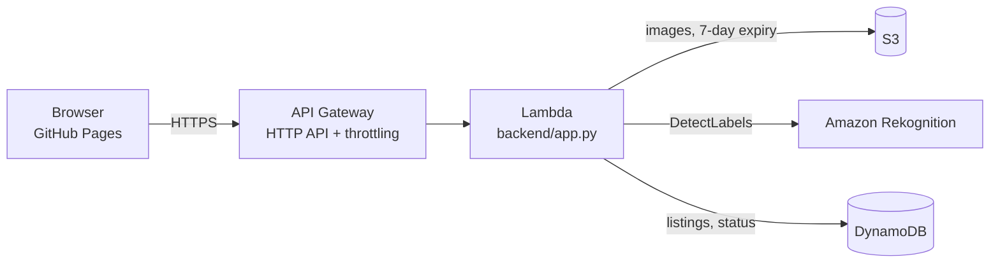

# ReLoop AI 🌱
**Scan it. Sort it. Recover its value.**
AI waste scanner + waste listing + recycler matching + pickup tracking + impact dashboard, on AWS serverless.

- **Live demo:** `<paste GitHub Pages URL>`
- **Demo video:** `<paste YouTube URL>`

## What works
1. **AI Waste Scanner** – photo → S3 + **Amazon Rekognition** `DetectLabels` → plastic / paper / metal / glass / e-waste, with confidence, advice and safety warning. Material-specific labels outweigh generic ones (a "Bottle" is weaker evidence than "Glass"). When the model is unsure or two categories are close, the UI asks the user to confirm and shows the alternatives.
2. **Waste listing** – category, weight, location saved in **DynamoDB**.
3. **Recycler matching** – by waste type and distance (or real km via *Use my location* on the map). Recycler records are **demo data, not real partners**.
4. **Pickups** – Matched → Scheduled (with a time slot) → Completed; search, filters, *view as recycler*, suggested collection order.
5. **Impact dashboard** – counts **only completed, saved listings**; seeded rows are labelled *demo*. 7-day chart, badges, CSV export, share text, downloadable certificate.
6. Disposal guide, scan history, light/dark theme.

## Architecture

Inputs are validated (image ≤ 4 MB, weight 0–5000 kg, one-step status transitions, recycler must accept the category). The Lambda role is least-privilege. The API is rate-limited (burst 10, 5 req/s).

## Run locally (no AWS account needed)
```bash
python scripts/dev_server.py        # open http://localhost:8000
```
Runs the real Lambda handler against an in-memory table, so listings, matching, pickups and the dashboard work fully. The scanner uses real Rekognition **only if** `pip install boto3` and `aws configure` are done (needs `rekognition:DetectLabels`); otherwise it falls back to manual category. Data resets when you stop the server.
Or just open `frontend/index.html` (browser-storage demo mode).

## Deploy to AWS
Prereqs: AWS account, AWS CLI and SAM CLI installed and configured (`aws configure`).
```bash
./scripts/deploy.sh                 # builds, deploys, writes the API URL into frontend/config.js
git add -A && git commit -m "Set API URL" && git push
```
Defaults: region `ap-south-1`, stack `reloop-ai`. Override with `AWS_REGION`, `STACK`. Once your Pages URL is known, lock CORS: `ORIGIN=https://<user>.github.io ./scripts/deploy.sh`.
In GitHub: Settings → Pages → Source: **GitHub Actions**.

**Cost safety:** everything is pay-per-use and free-tier friendly. Still, create an AWS Budget alert (e.g. $5) and delete the stack when done: `sam delete --stack-name reloop-ai`.

## Tests
`python -m unittest discover -s tests -v` (also runs in CI on every push).

## Assumptions & sources
The ₹/kg values, CO₂ factors and tree equivalents are **rough demo assumptions, not audited figures**.
- **CO₂ factors (kg CO₂e avoided per kg recycled):** plastic 1.5, paper 0.9, metal 4, glass 0.3, e-waste 2. These are illustrative averages chosen for the demo. The methodology reference is the [US EPA WARM model](https://www.epa.gov/warm); for scale, WARM lists recycling aluminium cans at about 9 MTCO2E per short ton (~10 kg CO₂e per kg), so the metal value of 4 is a mixed steel/aluminium average, not an aluminium figure. Replace with India-specific factors before any real reporting.
- **Tree equivalent:** about 25 kg CO₂ per tree per year, a commonly used average; published estimates range from roughly 10 to 40 kg depending on species, age and climate.
- **₹/kg values:** indicative scrap rates; real prices vary by city, grade and day.

## Limitations (honest)
- Rekognition is a general object model, not trained for waste; accuracy varies by photo. Next step: Rekognition Custom Labels or a Bedrock vision model.
- No login and no real recycler onboarding yet; add Cognito and a recycler role before production. The API is open but rate-limited.
- Impact, value and CO₂ numbers are indicative estimates, not audited. Demo records are labelled.

## 3-minute demo script
0:00 Problem · 0:25 scan a real item (pick one the model recognises well) · 1:00 create listing, show match on the map · 1:40 schedule and complete the pickup, dashboard updates · 2:15 AWS console (Lambda, DynamoDB item, S3 object) + architecture · 2:45 limitations and next steps.

MIT licensed. Built during the hackathon.
